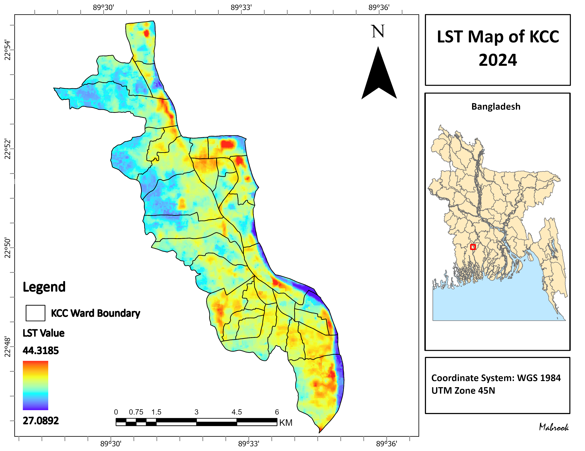
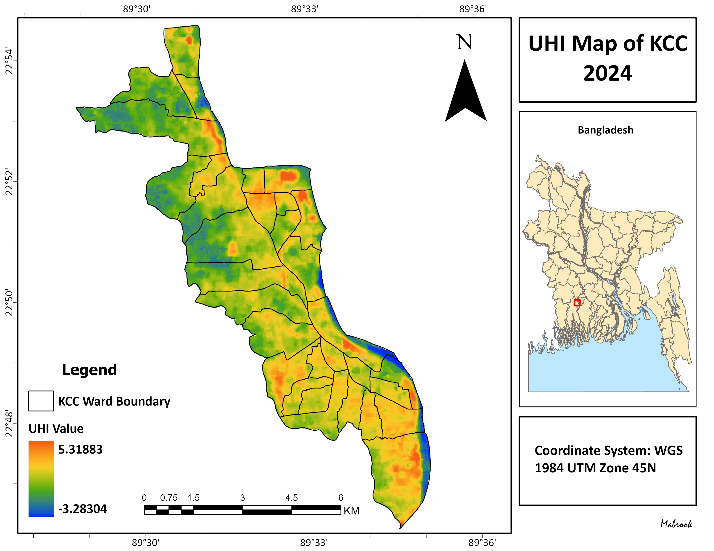
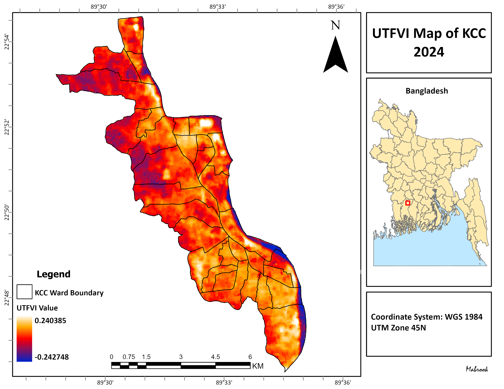

# Urban Heat Island and Thermal Mapping of Khulna City Corporation

Mapping land surface temperature (LST), the Urban Heat Island (UHI) intensity, and the Urban Thermal Field Variance Index (UTFVI) for Khulna City Corporation (KCC), Bangladesh, using Landsat 8 imagery from 2024, processed in Google Earth Engine and mapped in ArcGIS Pro.



## Objective
To identify how surface heat is distributed across Khulna City Corporation and where thermal stress is highest, and to examine the potential role of green spaces in reducing urban heat.

## Study Area
Khulna City Corporation (KCC), the third-largest city in Bangladesh, located in the southwestern delta region.

## Data
| Dataset | Source | Details |
|---|---|---|
| Landsat 8 OLI/TIRS Collection 2, Level 2 | USGS, via Google Earth Engine | January to December 2024, 30 m |
| KCC administrative boundary | KCC | Vector boundary (`data/kcc_boundary.geojson`) |

## Method
All satellite processing was done in Google Earth Engine (`gee/kcc_uhi_utfvi.js`):

1. **Image collection:** Landsat 8 scenes covering KCC from January to December 2024 were filtered by date and study area.
2. **Scaling:** Collection 2 scaling factors were applied to the optical (surface reflectance) and thermal (surface temperature) bands.
3. **Quality control:** Fill, cloud, dilated cloud, cirrus, and cloud-shadow pixels were masked using the QA_PIXEL band, and saturated pixels were removed using the QA_RADSAT band. The remaining pixels were combined into an annual median composite.
4. **Land Surface Temperature:** LST was taken from the Collection 2 Level 2 surface temperature band (ST_B10), which USGS has already corrected for atmospheric effects and land surface emissivity, and converted from Kelvin to °C.
5. **Urban Heat Island:** a normalized UHI index was calculated for each pixel:

   UHI = (LST − LST_mean) / LST_std

   where LST_mean and LST_std are the mean and standard deviation of LST across KCC. Positive values are hotter than the city average.

6. **Urban Thermal Field Variance Index:**

   UTFVI = (T_s − T_mean) / T_s

   where T_s is the pixel's LST and T_mean is the mean LST across KCC, both in **Kelvin** (the scale the standard thresholds are defined on). UTFVI values were classified into ecological evaluation classes:

   | UTFVI | UHI phenomenon | Ecological evaluation |
   |---|---|---|
   | < 0 | None | Excellent |
   | 0 – 0.005 | Weak | Good |
   | 0.005 – 0.010 | Middle | Normal |
   | 0.010 – 0.015 | Strong | Bad |
   | 0.015 – 0.020 | Stronger | Worse |
   | > 0.020 | Strongest | Worst |

7. **Vegetation and heat:** NDVI was calculated from the composite (bands 5 and 4), and its Pearson correlation with LST across all KCC pixels was used to examine the cooling role of green space.
8. **Export and mapping:** the LST, UHI, UTFVI, UTFVI class, and NDVI rasters were exported as GeoTIFFs (UTM zone 45N, 30 m) and styled into final maps in ArcGIS Pro.

## Results

| Land Surface Temperature | Urban Heat Island | UTFVI |
|---|---|---|
|  |  |  |

Key findings:
- LST ranged from **X °C to Y °C**, with a mean of **Z °C**.
- The highest temperatures were found in **[areas / land uses]**.
- About **N %** of KCC falls in the strongest UTFVI class ("Worst" ecological condition).
- NDVI and LST were **[negatively]** correlated (r = **R**), and areas with vegetation and water bodies, such as **[examples]**, showed noticeably lower surface temperatures.

## Repository Structure
```
├── gee/
│   └── kcc_uhi_utfvi.js        Google Earth Engine script
├── data/
│   └── kcc_boundary.geojson    Study area boundary
├── rasters/
│   ├── lst_kcc_2024.tif        Land surface temperature (°C)
│   ├── uhi_kcc_2024.tif        Normalized UHI index
│   ├── utfvi_kcc_2024.tif      UTFVI (continuous)
│   ├── utfvi_class_kcc_2024.tif  UTFVI ecological class (1 = Excellent … 6 = Worst)
│   └── ndvi_kcc_2024.tif       NDVI
├── maps/                       Final maps (PNG)
└── README.md
```

## How to Reproduce
1. Open the script directly in the Earth Engine Code Editor: [Open in GEE](https://code.earthengine.google.com/44fe1f6148d6655c1c24fd6959ecfc2f)
2. Upload `data/kcc_boundary.geojson` as a GEE asset and update the boundary path in the script if needed.
3. Run the script. The Console prints the scene count, LST statistics, UTFVI class areas, and the NDVI–LST correlation. Export the rasters from the Tasks tab.
4. The exported GeoTIFFs can be opened in ArcGIS Pro or QGIS for mapping.

## Limitations
- The analysis is based on an annual composite of cloud-free pixels; seasonal differences (e.g., pre-monsoon vs. winter) are not separated.
- LST represents surface temperature, not air temperature experienced by residents.
- Landsat 8's thermal band has a native resolution of 100 m (resampled to 30 m), which limits detail at the street level.

## Author
**Mabrook**, Department of Urban & Regional Planning, Khulna University of Engineering & Technology (KUET)
✉️ mkmabrook7@gmail.com
